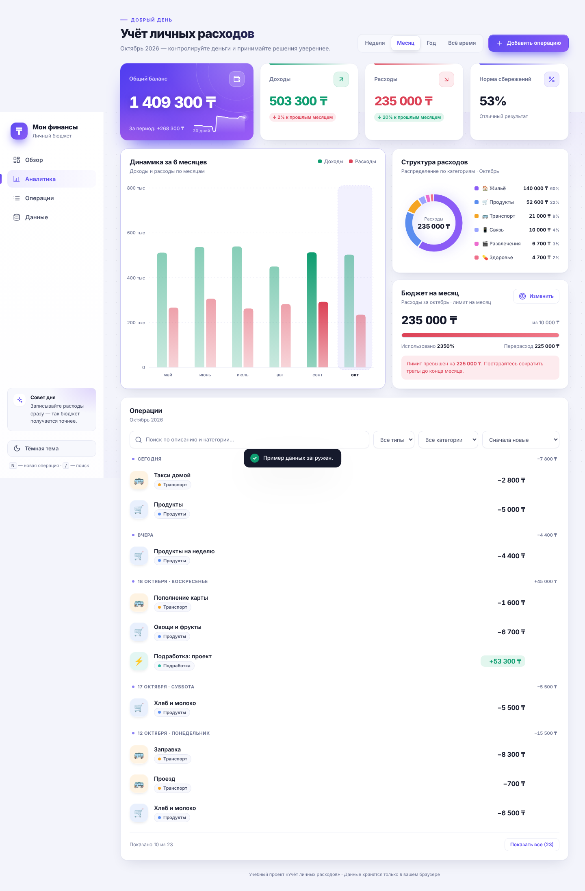

# Мои финансы — учёт личных расходов

Учебный проект по предметной области «Финансы». Современное браузерное приложение для учёта доходов и расходов: баланс, графики, бюджет на месяц, поиск, редактирование, экспорт и резервные копии. Не требует сервера и установки.



## Быстрый старт
1. Откройте `index.html` в браузере (Chrome, Edge, Firefox, Safari).
2. Нажмите «Добавить операцию» — или «Данные → Пример данных», чтобы увидеть приложение с готовыми записями.
3. Данные хранятся в `localStorage` вашего браузера. Записи из первой версии приложения подхватываются автоматически.

## Что нового в этой версии
- Новый дизайн: светлая и тёмная темы, анимации, адаптивная вёрстка (на телефоне — нижняя навигация и кнопка «+»).
- Периоды: неделя, месяц, год, всё время; сравнение с предыдущим периодом.
- Графики: динамика доходов/расходов за 6 месяцев и кольцевая диаграмма по категориям (с подсказками при наведении).
- Бюджет на месяц: лимит, прогресс, «сколько можно тратить в день».
- Норма сбережений (доля дохода, которая осталась).
- Редактирование операций, категории-«чипы» с иконками, группировка по дням.
- Фильтры: поиск, тип, категория, 4 вида сортировки.
- Экспорт в CSV (для Excel), резервная копия и восстановление JSON, пример данных.
- Собственные окна подтверждения вместо системных, горячие клавиши: `N` — новая операция, `/` — поиск.

## Структура папки
```
uchet-lichnyh-rashodov/
├── index.html            — разметка и диалоги
├── css/styles.css        — оформление, темы, адаптивность
├── js/app.js             — данные, расчёты, графики, импорт/экспорт
├── assets/               — иконка сайта и скриншоты
├── docs/
│   ├── PROJECT_REPORT.md — отчёт по проекту
│   ├── TEST_SCENARIOS.md — тестовые сценарии
│   └── DEMO.md           — сценарий демонстрации
└── README.md
```

## Технологии
HTML5, CSS3 (переменные, grid, `dialog`), JavaScript ES6+, SVG-графики без библиотек, `localStorage`, `Intl`. Шрифты Inter и Manrope подгружаются из Google Fonts; без интернета используются системные шрифты.

## Примечание
Данные не синхронизируются между устройствами и браузерами — для переноса используйте «Резервная копия».
